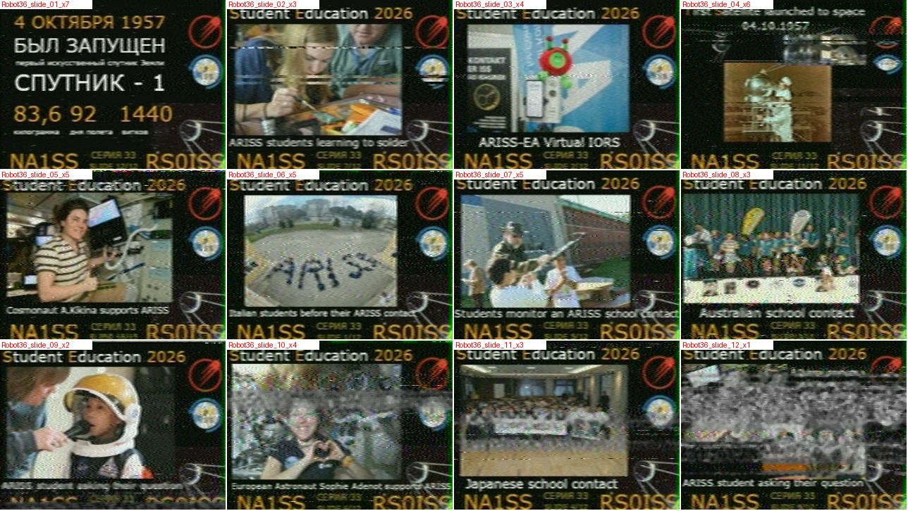
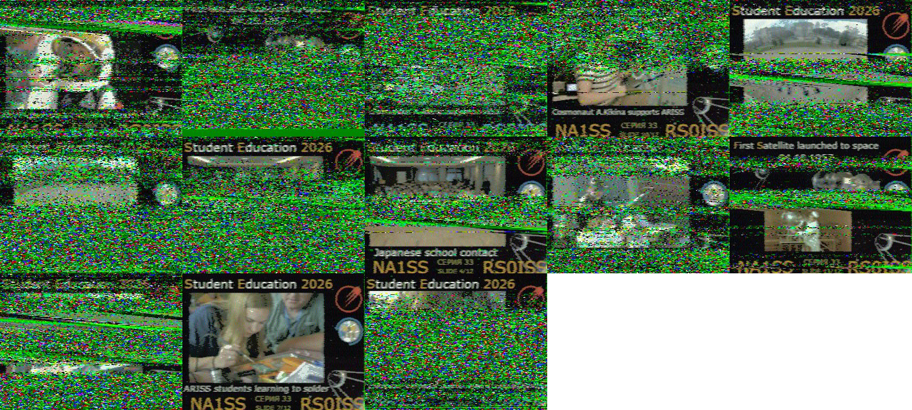
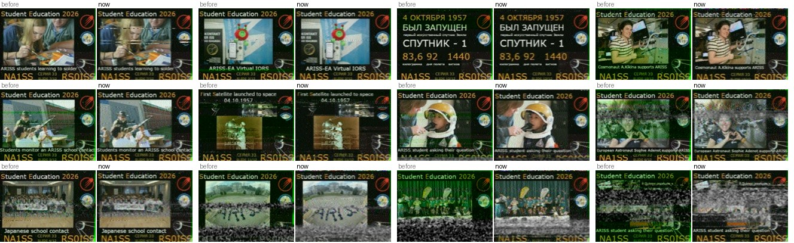

# ISS SSTV decoder for SatNOGS recordings

[](LICENSE)

Fetches ISS SSTV recordings from a [SatNOGS](https://network.satnogs.org)
ground station, decodes every image in every pass, and merges the repeat
transmissions of each slide into the cleanest possible picture.

Built for the W2MMD / Gloucester County Amateur Radio Club SatNOGS station
([223](https://network.satnogs.org/stations/223/)) during the October 2026
ARISS "Student Education 2026" SSTV event (Robot36, 437.550 MHz). It works for
any ISS SSTV event and any SatNOGS station.



*The full 12-slide deck from 24 passes over station 223. The `xN` label is
the number of received copies merged into each slide.*

## Quick start

Tested on a Raspberry Pi 5 (Debian 13, Python 3.13).

```bash
sudo apt install libsndfile1 ffmpeg          # ffmpeg only needed for dev/ tests
git clone https://github.com/w2mmdskunkworks/iss-sstv-satnogs.git
cd iss-sstv-satnogs
python3 -m venv venv
venv/bin/pip install -r requirements.txt

venv/bin/python iss_sstv.py --start 2026-10-02T09:00 --end 2026-10-06T16:00
```

Results go to `./sstv_event/`. Open `sstv_event/index.html`.

| Output | Contents |
|---|---|
| `stacked/` | one merged image per slide, `<mode>_slide_NN_x<copies>.png`, best first |
| `images/` | every individual decode, `<obs>_<date>_<time>_<n>_<mode>.png` |
| `index.html` | contact sheet: merged slides, then single decodes, with quality scores |
| `results.csv` | one row per decoded image (time, mode, quality, tuning offset) |
| `audio/`, `decoded/` | downloaded recordings and decode cache |

> Each run deletes and rewrites the PNGs in `stacked/` and `images/`. Copy
> any images you want to keep somewhere else first.

## Using your own station

The default station is 223. Use `--station` for a single run, or set the
`SATNOGS_STATION` environment variable once to change the default:

```bash
venv/bin/python iss_sstv.py --station 1234 --start 2026-10-02T09:00
export SATNOGS_STATION=1234             # e.g. in ~/.bashrc
```

Your station number is in its page URL on network.satnogs.org
(`.../stations/1234/`). The station must have recorded ISS passes, with
audio, on the SSTV downlink.

## Options

```bash
iss_sstv.py --station 1234              # another SatNOGS station (default 223)
iss_sstv.py --stations 223,1234         # several stations
iss_sstv.py --stations all              # whole network (not your own reception!)
iss_sstv.py --freq-mhz 145.800          # restrict downlink (default: 145.800 and 437.550)
iss_sstv.py --modes PD120               # restrict mode search (default: all ISS modes)
iss_sstv.py --slides 12                 # slides in the deck ("SLIDE x/N" on the images)
iss_sstv.py --files a.ogg b.wav         # decode local recordings
iss_sstv.py --files iq_123.raw          # SatNOGS IQ dump (48 kS/s int16 I/Q)
iss_sstv.py --raw                       # also save un-cleaned decodes
```

Reruns are cheap. Downloads and decodes are cached, and the cache is
invalidated automatically when the decoder code changes.

## For the next ISS SSTV event

1. From the ARISS announcement, note the **dates**, the **downlink** and the
   **mode**. Mode is often PD120; October 2026 used Robot36.
2. Make sure the station has ISS passes scheduled on that frequency.
3. Run with the event window. The downlink and mode are detected
   automatically.
4. If the slides say "SLIDE x/N" with N other than 12, add `--slides N`.

ARISS awards certificates for images from **your own** reception. Images
merged with other stations' recordings (`--stations all`) don't qualify.

## How it works

**Decoder** (`sstvdec/decoder.py`; mode tables in `sstvdec/modes.py`)
* **Finds every image** in a recording by correlating the full comb of sync
  pulses for each candidate mode: Robot36, PD50–PD290, and Martin 1/2.
  Scottie is supported but experimental. No VIS header is needed, so images
  with a corrupted header, or cut off at AOS/LOS, still decode. The VIS
  header is read where possible as confirmation.
* **Line timing** comes from a matched template on each line's trailing sync
  edge plus a robust line fit. That gives no slant, timing to about 10 µs,
  and a check for the one-line lock the VIS stop bit can cause.
* **Tuning offset** is measured on the sync tone through a narrow
  1200 Hz-centred filter and removed.
* **Pixel values** come from an amplitude-weighted (phasor-sum) frequency
  estimate per pixel, centred at 1900 Hz. Weak samples, where FM clicks come
  from, count for little, and pure noise comes out neutral grey rather than
  tinted.
* **Two filter widths.** Each image is rendered at two widths and blended row
  by row, using noise measured inside that row's sync pulse. Weak rows get
  the narrow filter, strong rows the sharper wide one.

**Stacker** (`sstvdec/stack.py`)
* **Grouping by schedule.** The ISS sends one image every ~159 s, cycling a
  deck of N slides. Onboard restarts shift the timing grid, which splits the
  event into runs. Within a run, the grid slot identifies the slide;
  template-removed picture matching links the runs.
* **Merging** is a per-pixel weighted median, with each row weighted by
  1/noise⁸. The cleanest copy dominates, and similar copies vote out clicks.
* **Cleanup** for display is noise-adaptive. On noisy rows, colour fades to
  grey instead of leaving colour blotches.

**Simulator** (`sstvdec/sim.py`) is the test bench that tunes all of the
above against the true image. It encodes with pysstv (an independent
encoder), sends the result through NBFM with noise and fading, demodulates
like gr-satnogs, and applies the same Vorbis encoding SatNOGS uses.

## Results

On station 223's passes from October 2–5, 2026:

| Version | Result |
|---|---|
| Original script (`sstv` library, VIS-triggered) | 13 noisy images, at most 1 per pass |
| This decoder, per pass | 48 usable images, 2–3 per pass |
| This decoder, merged | all 12 slides; 11 clean or nearly clean |



*Above: the original script's 13 decodes from 18 passes. Below: the earlier
Robot36-only stacker (left of each pair) against this version (right).*



Measured on the simulator:
* **Filter width.** The narrow filter wins by 3–4 dB on weak signals, and the
  wide one by 1–2 dB on strong signals, hence the per-row blend.
* **Merge weighting.** Weights of 1/noise⁸ beat 1/noise² by ~1 dB with 4
  copies.
* **OGG.** SatNOGS's OGG encoding (quality 1.0) costs essentially nothing.
* **IQ.** Decoding from the station's IQ dump gains only 1–2 dB, and only on
  the weakest signals.
* **Cleanup.** The noise-adaptive median is as good as NL-means or wavelets.
* **More passes beat everything else.** A slide with 3+ merged copies comes
  out clean.

## Development

```bash
venv/bin/pip install -r requirements-dev.txt
venv/bin/python dev/regress.py        # ~10 min on a Pi 5
```

`dev/regress.py` checks mode detection, line timing, tuning offset and
image PSNR for each mode family against the simulator's ground truth. Run it
after any change to `sstvdec/`. Calibration and evaluation harnesses:
* `dev/calib.py`: the per-mode filter-blend thresholds.
* `dev/eval_stack.py`: the merge and cleanup strategies.
* `dev/eval_merge2.py`: the merge-weighting variants.

`dev/test_photo.png` and `dev/test_text.png` are slides received during the
event, used as simulator test images.

| Path | What |
|---|---|
| `iss_sstv.py` | the program |
| `sstvdec/modes.py` | SSTV mode timing tables |
| `sstvdec/decoder.py` | multi-mode decoder |
| `sstvdec/stack.py` | grouping, merging, cleanup |
| `sstvdec/sim.py` | simulator / test bench |
| `dev/` | regression test, calibration and evaluation scripts |

## Background

The project began as a question in Claude chat. Could it take station 223's
ISS recordings, play them through Audacity into MMSSTV, and save the
pictures? Claude proposed decoding the recordings directly in Python instead,
and wrote a first script using the `sstv` library. That script was brought to
Claude Code on a club Raspberry Pi, where it was fixed, then replaced with
this decoder, stacker and simulator over three development phases.

## License

Copyright © 2026 Gloucester County Amateur Radio Club

This software is licensed under the MIT License. See the `LICENSE` file for
details.
